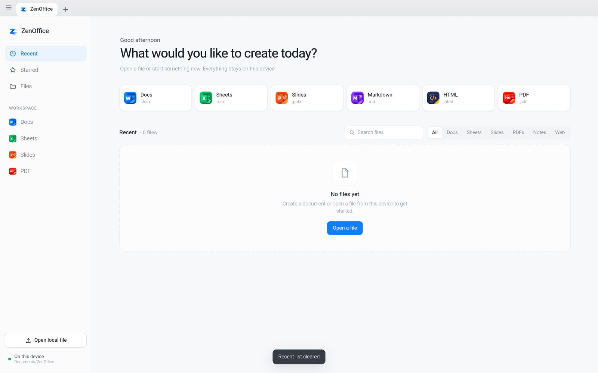
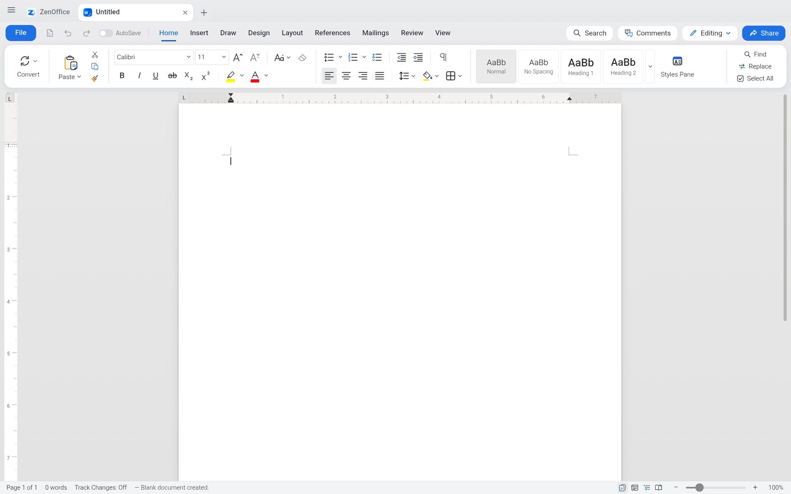
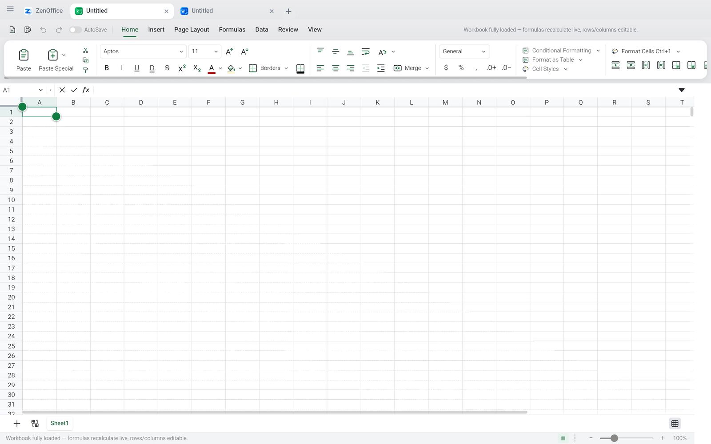
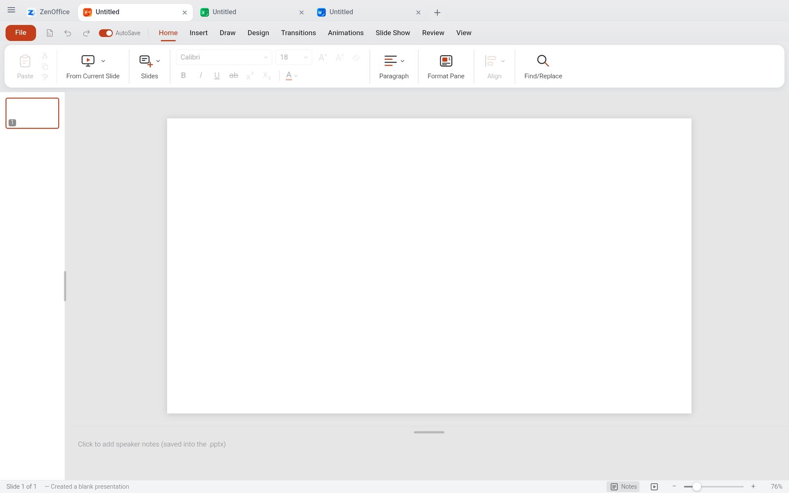
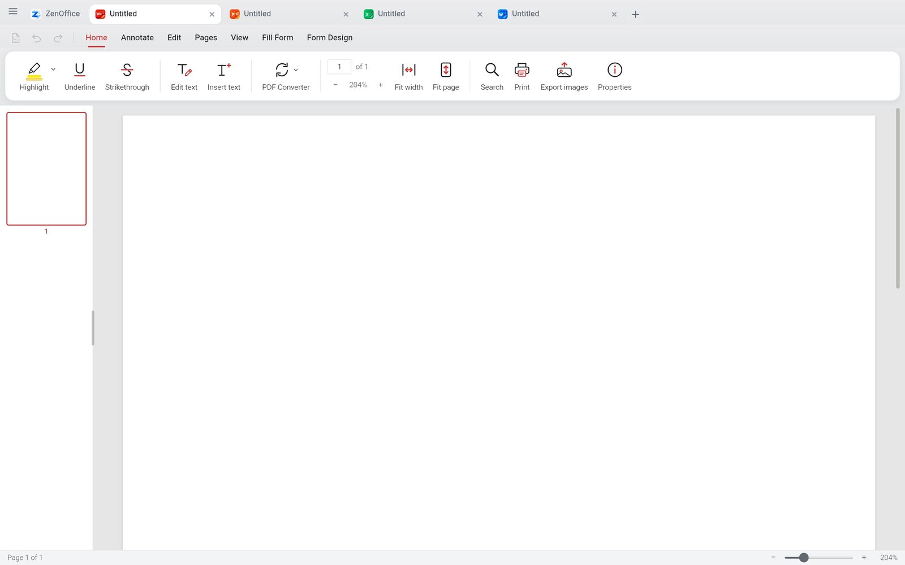
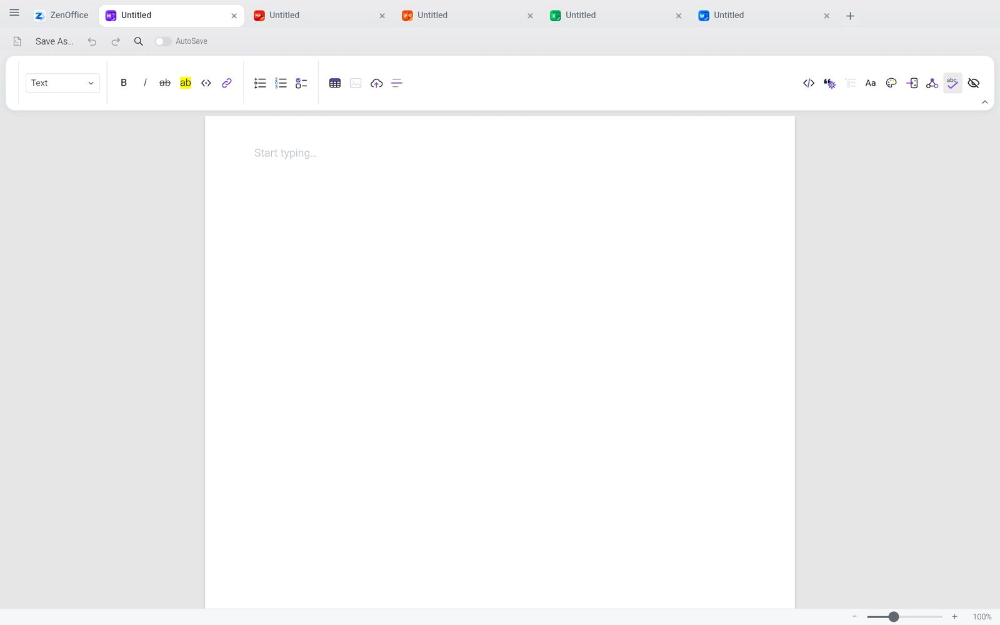
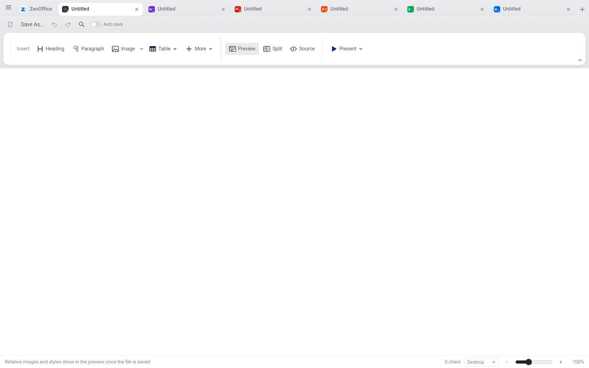
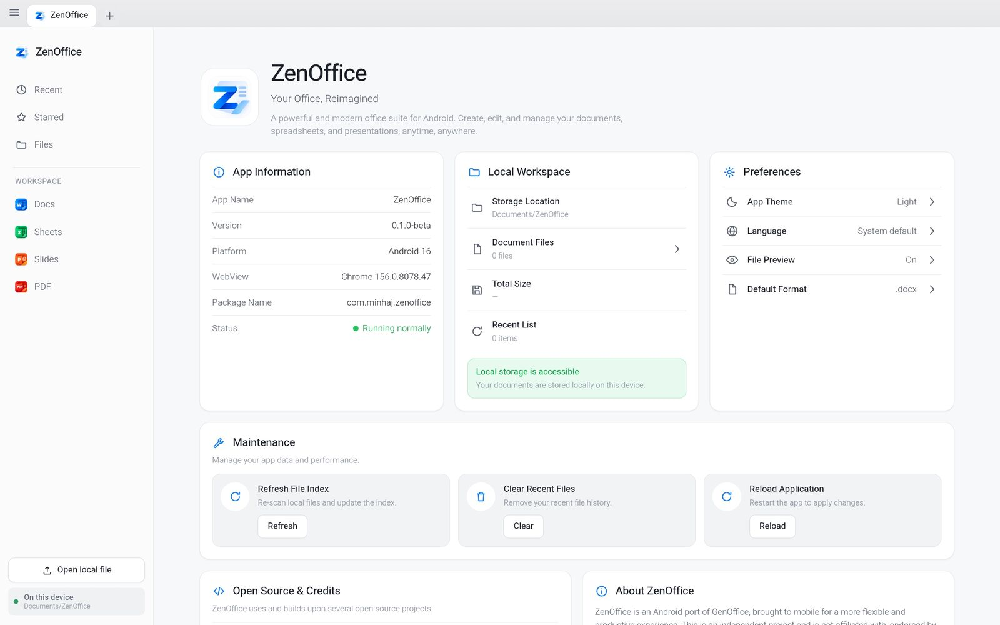
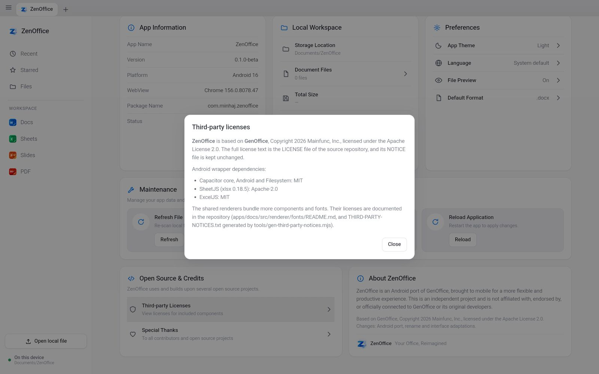

# ZenOffice

[English](README.md) · **Bahasa Indonesia**

Aplikasi office open-source untuk Android yang bekerja offline. Docs, Sheets,
Slides, PDF, Markdown, dan HTML dalam satu aplikasi yang ringan dan nyaman
disentuh. File Word, Excel, dan PowerPoint dibuka dan disimpan dalam format
aslinya.

> **Status: beta (0.1.0-beta).** Sudah bisa dipakai, tapi masih ada bagian yang
> belum mulus, terutama pada dokumen yang sangat besar.

[**Unduh APK**](https://github.com/asykaminhaj/ZenOffice/releases/latest) ·
[Privasi](PRIVACY.md) · [Dukung proyek ini](https://saweria.co/zenoffice)

  

## Fitur

- **Enam aplikasi dalam satu:** Docs (.docx), Sheets (.xlsx), Slides (.pptx),
  PDF, Markdown, dan HTML.
- **Format file asli.** Hanya bagian yang kamu ubah yang ditulis ulang, jadi
  file tetap bisa dibuka di Word, Excel, dan PowerPoint.
- **Bekerja offline.** Dokumen dibuka, diedit, dan disimpan di perangkatmu.
- **Layar utama dengan file terbaru dan indeks lokal** untuk dokumen di
  Documents/ZenOffice (gunakan Refresh Index setelah menambah file).
- **Buka file dari aplikasi lain** dan dari file manager.
- **Ekspor dan cetak:** ekspor dari Docs, Slides, dan PDF (termasuk Word ke PDF), dan cetak Docs lewat dialog cetak Android.
- **Alat PDF:** edit teks, tambah anotasi, isi formulir, dan simpan PDF.
- **Aman saat mengedit:** aplikasi menanyakan simpan sebelum dokumen ditutup, dan Docs serta Sheets punya auto-recovery.
- **Dibuat untuk layar sentuh:** tampilan layar penuh dan antarmuka yang ramah
  tablet.

## Tangkapan layar

<table>
<tr>
<td width="50%"> <b>Docs</b>: dokumen Word</td>
<td width="50%"> <b>Sheets</b>: lembar kerja Excel</td>
</tr>
<tr>
<td> <b>Slides</b>: presentasi PowerPoint</td>
<td> <b>PDF</b>: lihat dan kerjakan file PDF</td>
</tr>
<tr>
<td> <b>Markdown</b></td>
<td> <b>HTML</b></td>
</tr>
<tr>
<td> <b>Tentang</b></td>
<td> <b>Tentang</b>: detail</td>
</tr>
</table>

## Pemasangan

1. Unduh `ZenOffice-0.1.0-beta.apk` dari
   [rilis terbaru](https://github.com/asykaminhaj/ZenOffice/releases/latest).
2. Opsional: periksa keaslian file. SHA-256 harus sama dengan isi file
   `.sha256` di halaman rilis. Di terminal: `sha256sum ZenOffice-0.1.0-beta.apk`
3. Buka APK dan izinkan pemasangan dari sumber ini saat Android menanyakan.
4. Saat pertama dibuka, ZenOffice meminta **Akses semua file**. Izin ini
   dipakai untuk menampilkan dokumen di `Documents/ZenOffice` yang diletakkan
   aplikasi lain atau file manager. File tetap ada di perangkatmu. Kalau
   ditolak, kamu masih bisa membuka file lewat pemilih file bawaan sistem.

Diuji di Android 16 (arm64).

## Keterbatasan

- Ini perangkat lunak beta: cadangkan dokumen penting sebelum mengeditnya.
- Dokumen yang sangat besar bisa lambat dibuka dan diedit.
- Autosave mati secara default; aplikasi menanyakan simpan sebelum dokumen yang belum disimpan ditutup.
- Sebagian fitur lanjutan dari GenOffice desktop tidak tersedia (lihat di bawah).
## Perbedaan dengan GenOffice

ZenOffice adalah port Android, jadi tidak identik dengan aplikasi desktop.

- Dibangun dengan Capacitor (`mobile/`), paket `com.minhaj.zenoffice`.
- Panel AI dinonaktifkan, dan shell desktop (termasuk analitiknya) tidak ikut
  dalam build ini.
- Ada pembantu native untuk membuka file dari aplikasi lain, Simpan sebagai PDF,
  dan Cetak.

## Membangun dari sumber

Butuh Node (lihat `.nvmrc`), JDK 21, dan Android SDK (platform 35).

    npm ci --ignore-scripts
    node mobile/scripts/build-web.mjs
    cd mobile && npm ci
    npx cap add android && npx cap sync android
    node scripts/patch-android.mjs
    cd android && ./gradlew assembleDebug

Penandatanganan rilis membaca `~/keys/keystore.properties`, atau path di
`ZENOFFICE_KEYSTORE_PROPS`. Tanpa itu hanya build debug yang dihasilkan.
Workflow GitHub Actions (`.github/workflows/android-apk.yml`) membangun APK
debug.

## Dukungan

Kalau ZenOffice bermanfaat, kamu bisa mendukung pengembangannya:
https://saweria.co/zenoffice

## Kredit dan lisensi

ZenOffice adalah port independen dari
[GenOffice](https://github.com/genspark-ai/genoffice) milik Mainfunc, Inc. Proyek
ini tidak berafiliasi dengan, dan tidak didukung oleh, Mainfunc, Inc. maupun
Genspark.

Berlisensi Apache License 2.0. Lihat [LICENSE](LICENSE) dan [NOTICE](NOTICE).
