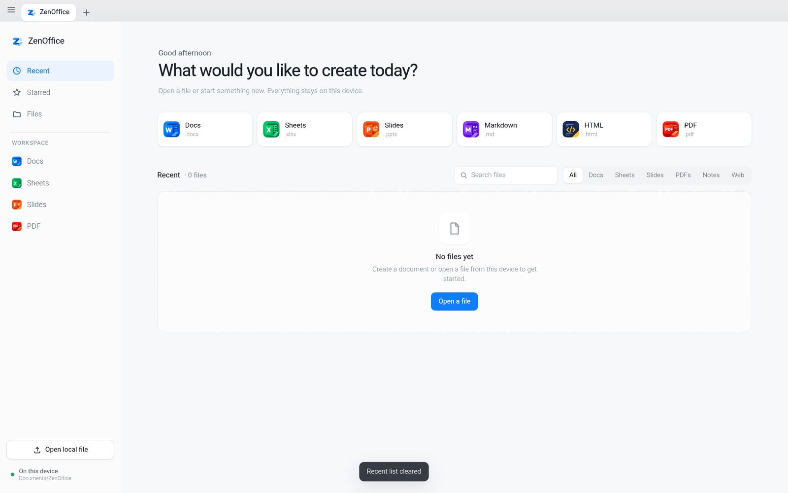
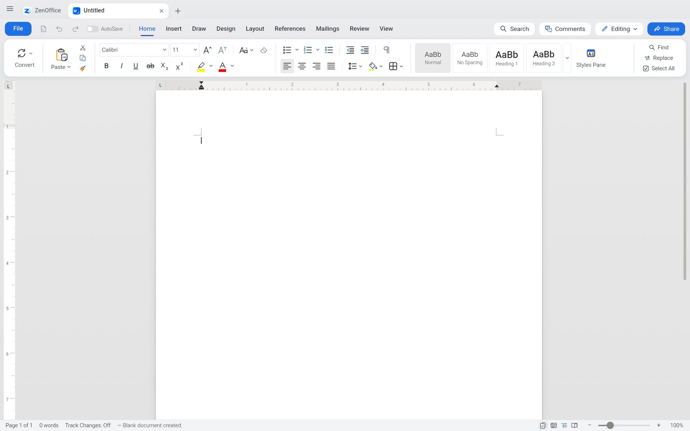
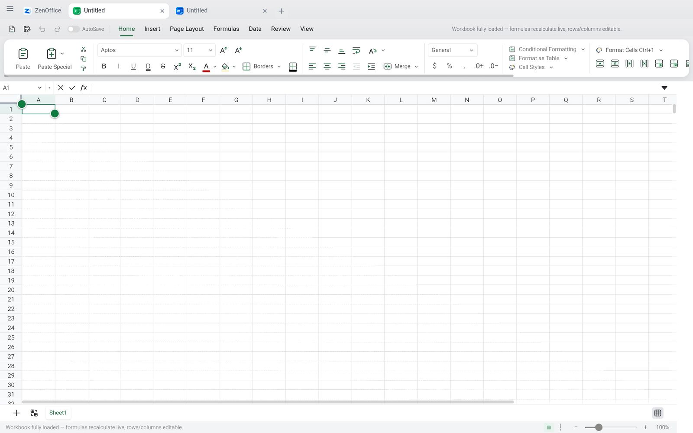
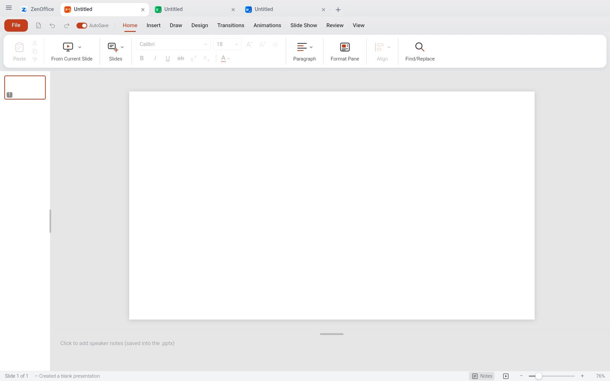
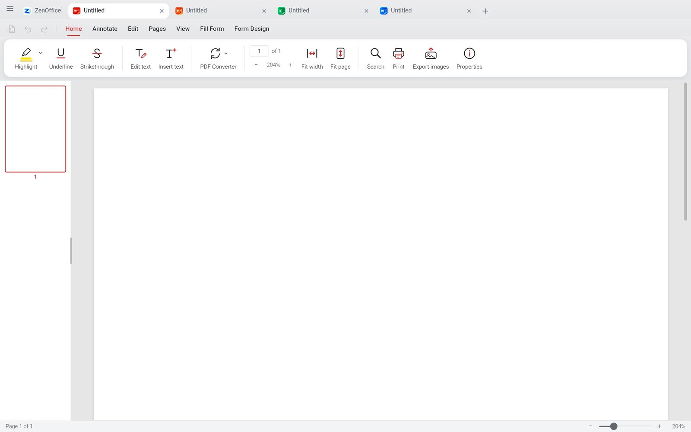
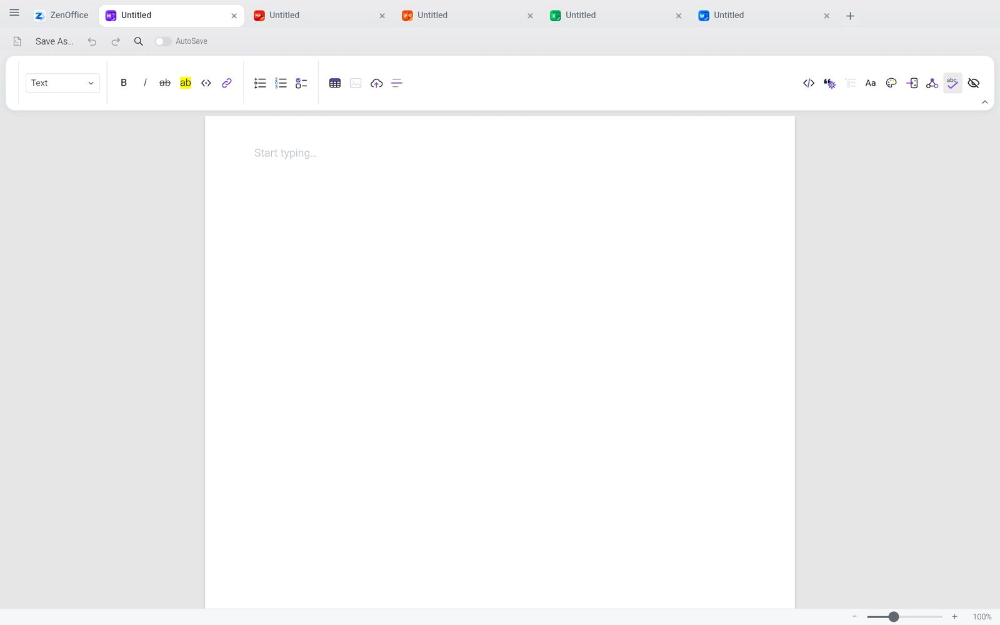
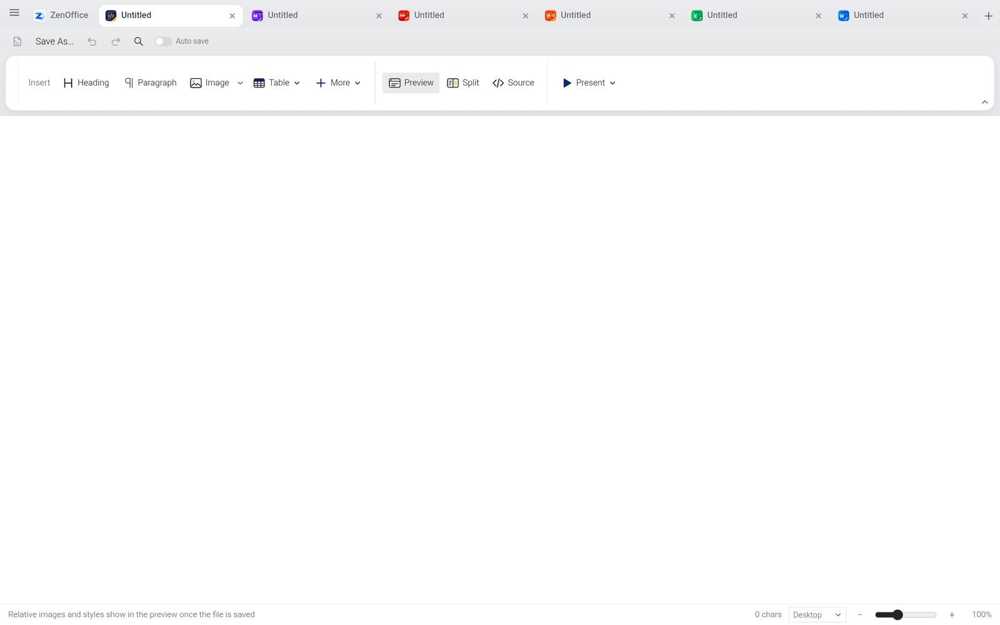
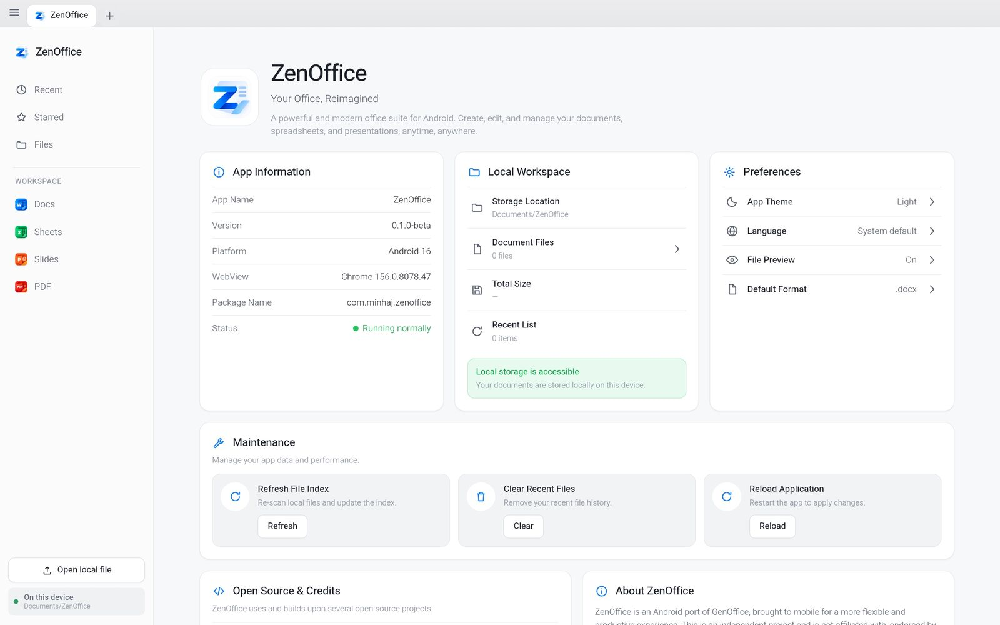
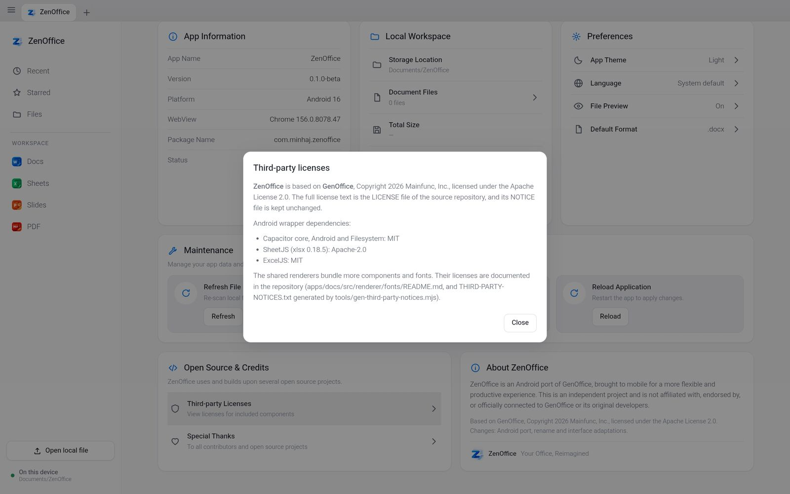

# ZenOffice

**English** · [Bahasa Indonesia](README.id.md)

An offline, open-source office suite for Android. Docs, Sheets, Slides, PDF,
Markdown and HTML in one lightweight, touch-optimized app. Word, Excel and
PowerPoint files are opened and saved in their real formats.

> **Status: beta (0.1.0-beta).** It works, but expect rough edges, especially
> with very large documents.

[**Download the APK**](https://github.com/asykaminhaj/ZenOffice/releases/latest) ·
[Privacy](PRIVACY.md) · [Support the project](https://saweria.co/zenoffice)

  

## Features

- **Six apps in one:** Docs (.docx), Sheets (.xlsx), Slides (.pptx), PDF,
  Markdown and HTML.
- **Real file formats.** Only what you edit is rewritten, so your files keep
  working in Word, Excel and PowerPoint.
- **Works offline.** Documents are opened, edited and saved on your device.
- **Home screen with recent files and a local index** of the documents in
  Documents/ZenOffice (use Refresh Index after adding files).
- **Open files from other apps** and from your file manager.
- **Save as PDF and Print** from the document apps.
- **Built for touch:** immersive full-screen layout and tablet-friendly UI.

## Screenshots

<table>
<tr>
<td width="50%"> <b>Docs</b>: Word documents</td>
<td width="50%"> <b>Sheets</b>: Excel workbooks</td>
</tr>
<tr>
<td> <b>Slides</b>: PowerPoint decks</td>
<td> <b>PDF</b>: view and work with PDF files</td>
</tr>
<tr>
<td> <b>Markdown</b></td>
<td> <b>HTML</b></td>
</tr>
<tr>
<td> <b>About</b></td>
<td> <b>About</b>: details</td>
</tr>
</table>

## Install

1. Download `ZenOffice-0.1.0-beta.apk` from the
   [latest release](https://github.com/asykaminhaj/ZenOffice/releases/latest).
2. Optional: verify the file. The SHA-256 must match the `.sha256` file in the
   release. On a computer or in a terminal: `sha256sum ZenOffice-0.1.0-beta.apk`
3. Open the APK and allow installing from this source when Android asks.
4. On first launch, ZenOffice asks for **All files access**. It is used to list
   the documents in `Documents/ZenOffice` that other apps or your file manager
   put there. Files stay on your device. If you decline, you can still open
   files with the system file picker.

Tested on Android 16 (arm64).

## Known limitations

- Beta software: back up important documents before editing them.
- Very large documents can be slow to open and edit.
- Some advanced features from the desktop GenOffice are not available (see
  below).

## Differences from GenOffice

ZenOffice is an Android port, so it is not identical to the desktop app.

- Built with Capacitor (`mobile/`), package `com.minhaj.zenoffice`.
- The AI panel is disabled, and the desktop shell (including its analytics) is
  not part of this build.
- Native helpers for opening files from other apps, Save as PDF and printing.

## Build from source

Requires Node (see `.nvmrc`), JDK 21 and the Android SDK (platform 35).

    npm ci --ignore-scripts
    node mobile/scripts/build-web.mjs
    cd mobile && npm ci
    npx cap add android && npx cap sync android
    node scripts/patch-android.mjs
    cd android && ./gradlew assembleDebug

Release signing reads `~/keys/keystore.properties`, or the path in
`ZENOFFICE_KEYSTORE_PROPS`. Without it only debug builds are produced. A GitHub
Actions workflow (`.github/workflows/android-apk.yml`) builds a debug APK.

## Support

If ZenOffice is useful to you, you can support its development:
https://saweria.co/zenoffice

## Credits and license

ZenOffice is an independent port of
[GenOffice](https://github.com/genspark-ai/genoffice) by Mainfunc, Inc. It is
not affiliated with or endorsed by Mainfunc, Inc. or Genspark.

Licensed under the Apache License 2.0. See [LICENSE](LICENSE) and
[NOTICE](NOTICE).
